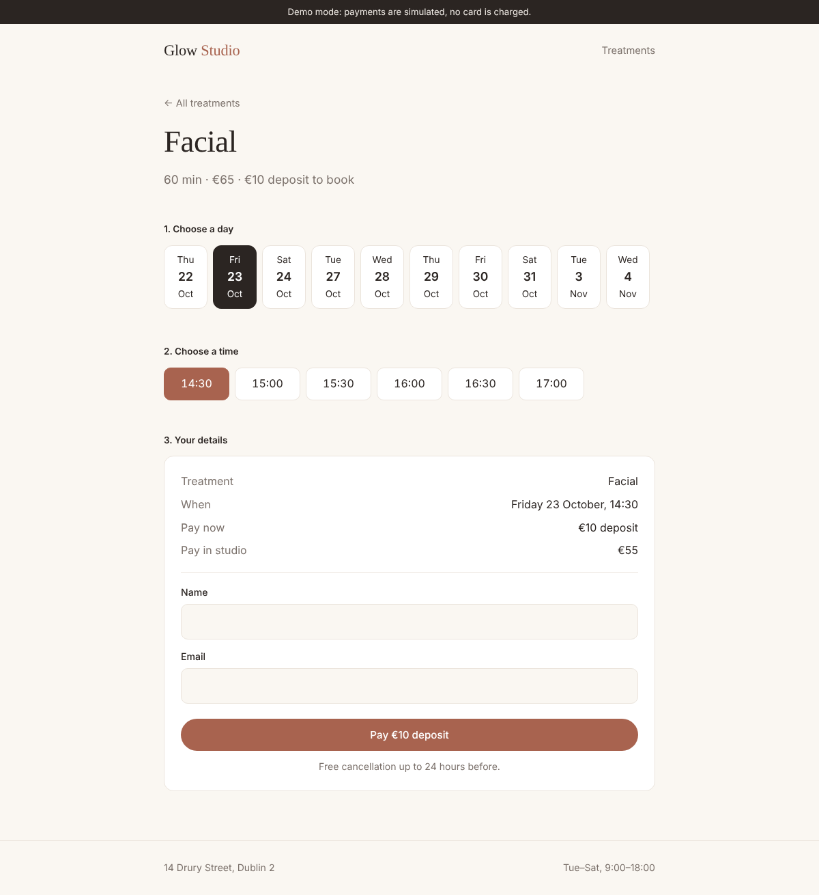
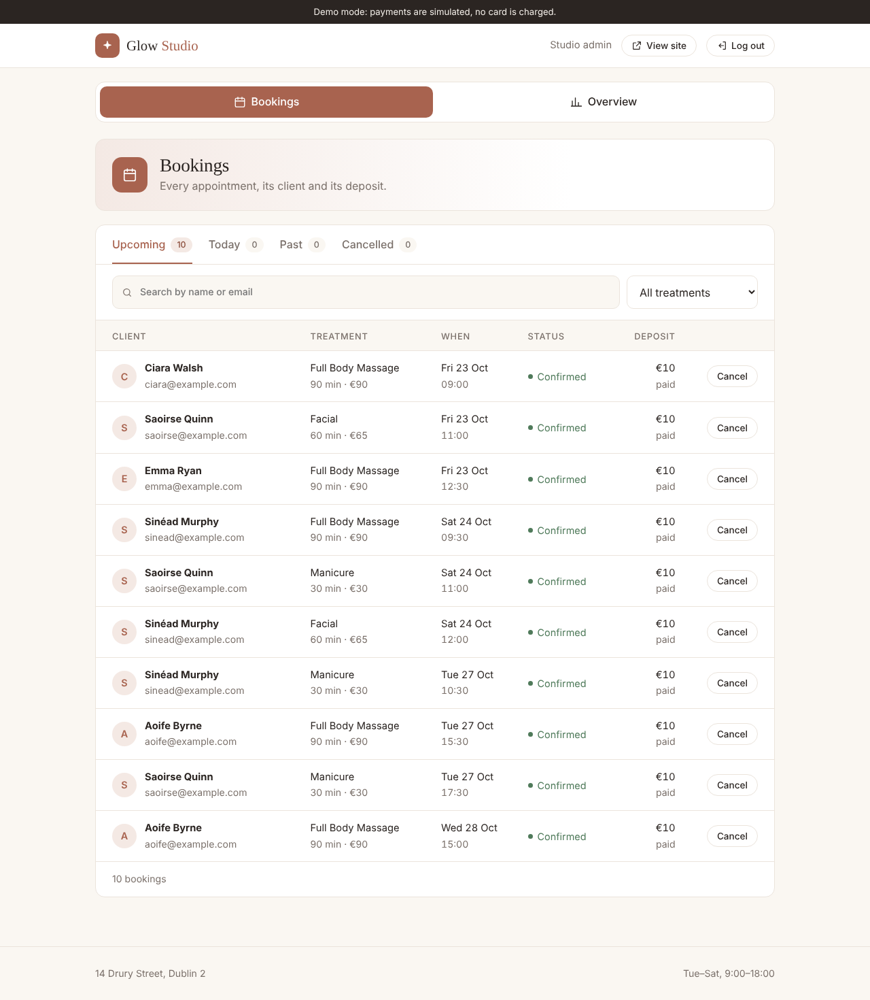
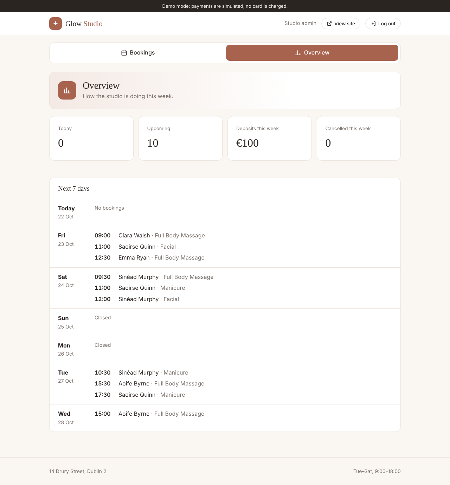
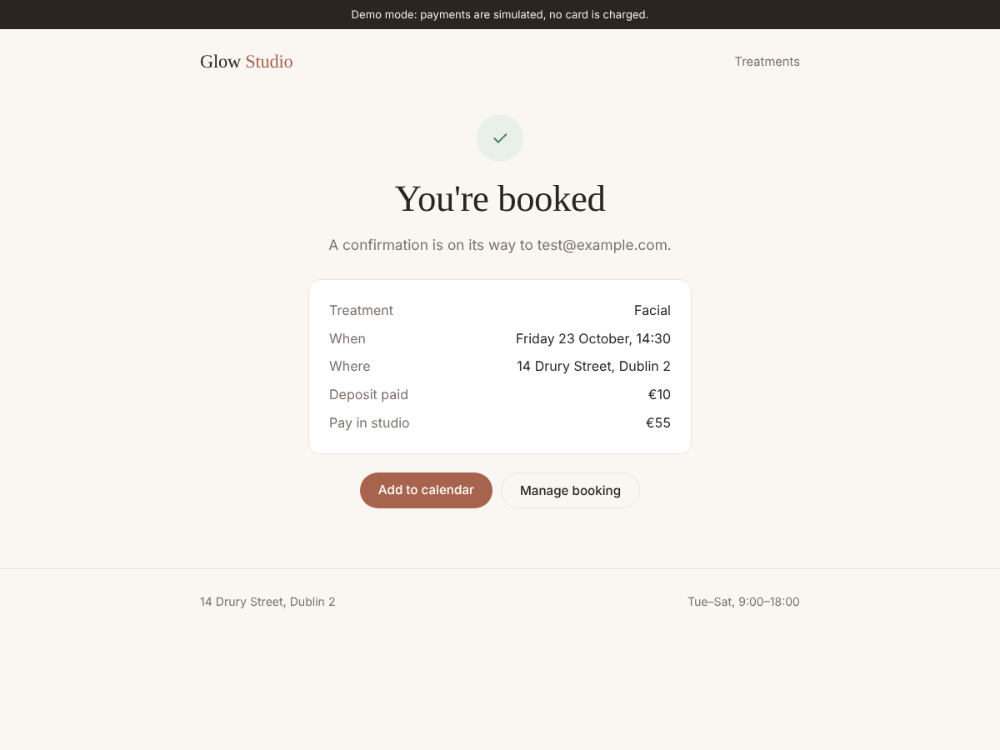
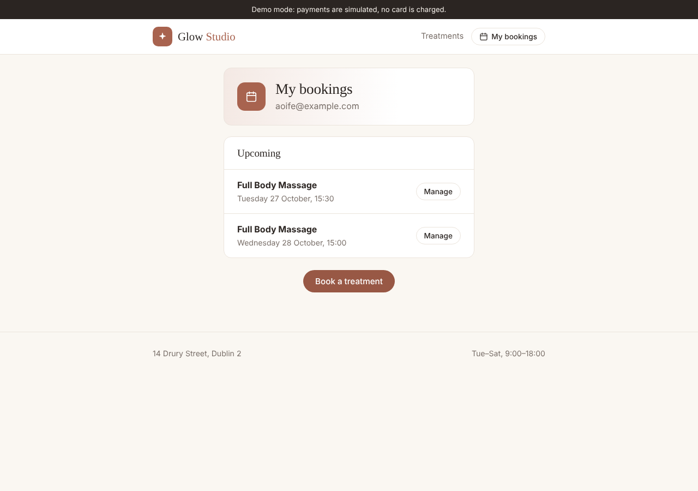

# Glow Studio

Online booking and deposits for a small beauty and wellness studio. Customers pick a treatment and a time, pay a €10 deposit with Stripe, and get a confirmation email. The owner gets a Slack alert and manages everything from a simple dashboard.



## Features

- **Live availability**: only free times are shown, based on opening hours and treatment length
- **No double-booking**: a time is locked the moment someone starts checking out, even if two people click at once
- **Stripe deposits**: Stripe Checkout, confirmed by a signed webhook
- **Unpaid holds expire**: if checkout isn't finished within 30 minutes, the time is released
- **Self-service cancellation**: a link in the confirmation email; cancel 24+ hours ahead and the deposit is refunded automatically through Stripe
- **Emails**: confirmation, 24-hour reminder and cancellation (Resend)
- **Slack alerts** for new bookings and cancellations
- **Add to calendar** link
- **Find my booking**: customers enter their email and get a one-hour link listing their bookings, no account needed
- **Owner dashboard**: bookings by tab (upcoming, today, past, cancelled) with search and filters, a weekly overview, and one-click cancel and refund
- **Demo mode**: runs with no keys at all, simulating payments, emails and Slack

| | |
|---|---|
|  |  |
|  |  |

## Tech

Python, Flask, MongoDB, Stripe, Resend, Slack webhooks, APScheduler, plain CSS. Tested with pytest.

## Run it locally

```bash
python -m venv .venv && source .venv/bin/activate
pip install -r requirements.txt
cp .env.example .env
flask --app wsgi run
```

Open http://localhost:5000 (or run `python3 main.py` for http://localhost:5001). With no keys set it runs in demo mode with sample bookings. The dashboard is at `/admin` (password `demo` unless you set `ADMIN_PASSWORD`).

Run the tests with `pytest`.

## Connecting the real services

All settings live in environment variables (see `.env.example`).

| Variable | Where to get it |
|---|---|
| `MONGO_URI` | MongoDB Atlas or a Railway MongoDB database |
| `STRIPE_SECRET_KEY` | Stripe dashboard → Developers → API keys (use the test key) |
| `STRIPE_WEBHOOK_SECRET` | Stripe dashboard → Developers → Webhooks, after adding the endpoint below |
| `RESEND_API_KEY` | resend.com → API Keys |
| `SLACK_WEBHOOK_URL` | Slack → Apps → Incoming Webhooks |
| `BASE_URL` | Your live site address, used in email links (optional locally) |
| `SECRET_KEY`, `ADMIN_PASSWORD` | Any long random strings you choose |

Stripe webhook endpoint: `https://<your-site>/stripe/webhook`, listening for `checkout.session.completed` and `checkout.session.expired`.

To test webhooks locally: `stripe listen --forward-to localhost:5000/stripe/webhook`.

Pay with Stripe's test card `4242 4242 4242 4242`, any future date and any CVC.

## Deploying to Railway

1. New project → Deploy from GitHub repo → select this repo.
2. Add a MongoDB database (or use Atlas) and set the variables above.
3. Railway starts the app with the `Procfile`. It runs a single worker so the background jobs (expiring holds, sending reminders) run once.
4. Set `BASE_URL` to the Railway URL and add the Stripe webhook endpoint.

## How it works

- **Slots** (`app/bookings.py`): each day is split into 30-minute blocks. A treatment occupies one or more blocks, and a block is reserved by inserting a document whose `_id` is its start time. MongoDB's unique `_id` makes it impossible for two bookings to hold the same block.
- **Payments** (`app/payments.py`): a booking starts as `pending`, holding its blocks. It only becomes `confirmed` when Stripe's signed webhook says the payment succeeded. If a payment arrives after the hold expired and the time has been taken, the deposit is refunded automatically.
- **Background jobs** (`app/scheduler.py`): every minute, unpaid holds older than 30 minutes are released. Every five minutes, reminders go out for appointments in the next 24 hours, each claimed atomically so it is only sent once.
- **Times** are stored in UTC and shown in Dublin time.
